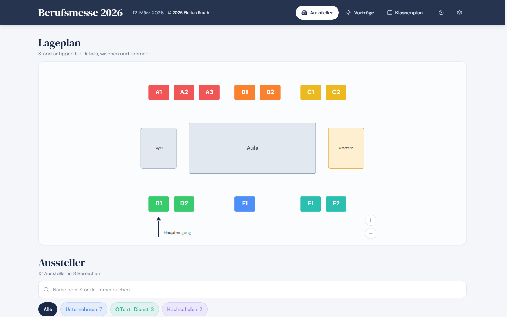

# Messeplan

A web platform for school education fairs. Teachers manage exhibitors, talks, class rotations and the floor plan in an
admin area; students use the public site to find their way around. Built with [Astro](https://astro.build),
[Svelte](https://svelte.dev), [Drizzle ORM](https://orm.drizzle.team) on SQLite and TypeScript. The user interface is in
German.



## Features

- **Exhibitors**: all companies and institutions by zone, with search, category filter and an interactive floor plan.
- **Talks**: the programme by time, filterable by format, category and room.
- **Class schedule**: each class's personal timeline plus an overview of all classes per zone and time slot.
- **Admin area**: password-protected management of all content, including a floor plan editor with multiple floors,
  snapping, areas, arrows and labels, and JSON backup export/import. Zones, categories, school tracks and time slots
  are configurable, so the platform adapts to any school.
- **Live updates**: open pages refresh automatically when an admin changes something.

## Development

Requires Node.js 24 or newer.

```sh
npm install
npm run dev          # dev server on http://localhost:4321
npm test             # unit tests
npm run test:e2e     # end-to-end tests (once before: npx playwright install chromium)
npm run build        # type-check and build into dist/
npm start            # run the built server from the project root (HOST and PORT are honoured)
npm run db:generate  # create a migration after changing src/server/db/schema.ts
```

On first start the server creates the database, applies the migrations in `drizzle/` and prints a generated admin
password. Change it any time with `npm run password`, which also signs out all admins.

## Configuration

| Variable         | Default               | Purpose                                                |
|------------------|-----------------------|--------------------------------------------------------|
| `DATABASE_PATH`  | `data/messeplan.db`   | SQLite database file                                   |
| `ADMIN_PASSWORD` | random                | Initial admin password, only used when none is set yet |
| `HOST`, `PORT`   | `localhost`, `4321`   | Listen address of the built server                     |

Event name, date, logo and the imprint link shown in the footer are set in the admin area under "Einstellungen".
Sessions are stored in `data/sessions`. In production the session cookie is marked secure, so serve the site over
HTTPS. Back up the `data/` folder or use the JSON export in the admin area.

## AI notice

Large parts of this project were written with the help of AI ([Claude Code](https://claude.com/claude-code)).
All changes are reviewed and tested before they are published.
